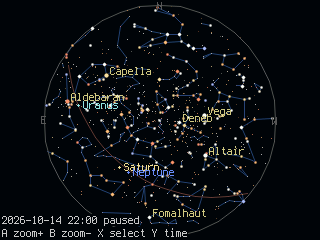
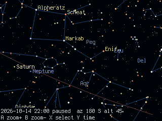

# picostellar

A planetarium for CircuitPython on the
[picogame](https://picogame.makerclass.cz) engine: 8,400 stars, constellation
lines and names, the Sun, the Moon with its phase and the planets, for any
place, date and time. It runs on microcontrollers of the RP2040 class and up
and was made for the [PicoPad](https://picopad.eu/en/) and the Adafruit Fruit
Jam.

 

picostellar is a showcase of the latest CircuitPython features, all of them
arriving in full with CircuitPython 11:

- **picogame**, the game engine inside the firmware: it draws the sky in
  strips, so the chart needs no screen-sized buffer.
- **turbo**, native code written in Python: the projection and the drawing
  are viper functions compiled to machine code and loaded as `.mpy`.
- **xip_map**, files mapped from flash: the 90 KB star catalogue is read in
  place and never copied to RAM.

How it works, with the numbers: [docs/internals.md](docs/internals.md).

## Install

Firmware: CircuitPython 11 with the `picogame` module and turbo (native
`.mpy` loading).

Copy the contents of `CIRCUITPY/` onto the board's drive:

```
CIRCUITPY/
  code.py                    three lines: import the app and run it
  sky.bin                    the catalogue
  icon.bmp                   launcher icon
  lib/
    picostellar.mpy          the app
    skyastro.mpy             the six modules
    skybuffer.mpy
    skycatalog.mpy
    skykernel.mpy
    skyparams.mpy
    skyview.mpy
    skyviper.armv6m.mpy      native kernels for an RP2040 board (PicoPad)
    skyviper.armv7emsp.mpy   native kernels for an RP2350 board (PicoPad 2, Fruit Jam)
    picogame_game.mpy        three helpers from the picogame-libs bundle
    picogame_input.mpy       (https://github.com/MakerClassCZ/picogame-libs)
    picogame_clock.mpy
```

The board picks the `skyviper` file for its chip. Your `settings.toml` stays
as it is; these keys are optional:

```
PICOSTELLAR_LAT = 50.09                # observer, degrees north (default Prague)
PICOSTELLAR_LON = 14.42                # degrees east
PICOSTELLAR_TZ = 2                     # hours east of UTC, for the clock in the corner
PICOSTELLAR_TIME = "2026-10-14 22:00"  # a fixed local start time instead of the board's clock
```

Without `PICOSTELLAR_TIME` the chart follows the board's clock when it has
been set, and otherwise starts on a demo evening.

## Controls

The buttons are picogame's. The PicoPad has them on board, the Fruit Jam
takes a [USB gamepad or keyboard](https://picogame.makerclass.cz/helpers/input/),
and a board of your own gets its map in `settings.toml` as described under
[Build your own board](https://picogame.makerclass.cz/custom-board/).
You might need the appropriate input libraries from [picogame-libs](https://github.com/MakerClassCZ/picogame-libs).

Four modes. B always goes back, A always goes in, Y walks LOOK or SELECT ->
TIME -> MENU -> back. The bottom line shows what each button does.

| mode | D-pad | A | B | X | Y |
|---|---|---|---|---|---|
| LOOK | pan (turn the chart in the whole-sky view) | zoom in, towards the bottom of the chart | zoom out | SELECT | TIME |
| SELECT | jump to the nearest object that way; hold to glide | centre on it and zoom in | back to LOOK | zoom out | TIME |
| TIME | left/right an hour, up/down a day (hold to run) | now (live clock) | back | tonight 22:00 | MENU |
| MENU | pick an item | switch it | close | | close |

In SELECT the card names the object: a star's name or "Star", its
constellation and magnitude; a planet's distance; the Moon's phase; and the
altitude and azimuth. The menu switches constellation lines, their smoothing,
star names, the ecliptic, a red night mode, the animation level and the
backlight where there is one.

## Data and licence

Yale Bright Star Catalogue 5 (public domain), constellation lines and names
from d3-celestial (BSD-3-Clause, Olaf Frohn) and star names from the IAU
Working Group on Star Names (CC BY 4.0); the sources and their licences are
in `data/`. The code is MIT, see `LICENSE`.
